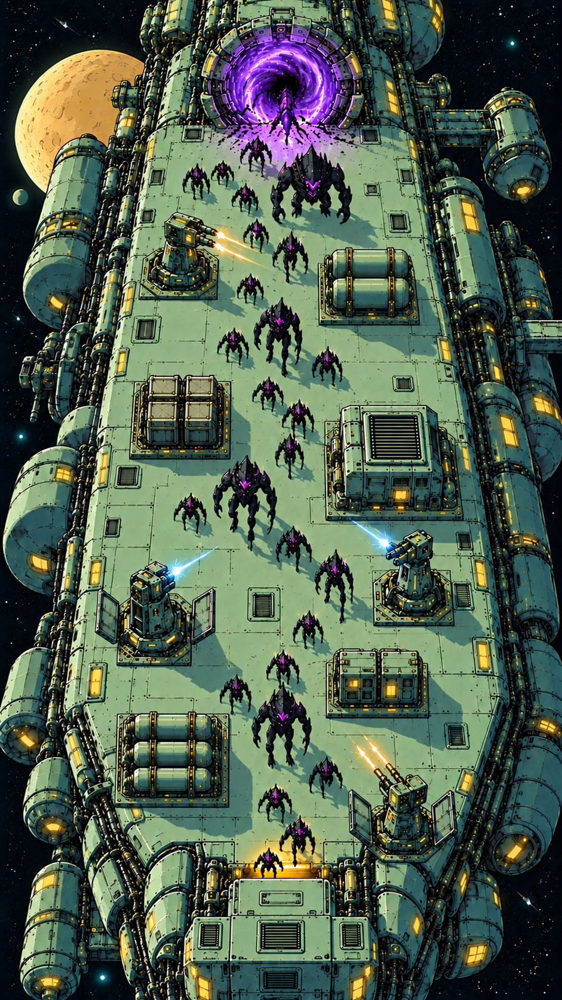

# TowerNexus — Retro Science-Fiction Concept Prompts

Visual direction selected on 2026-11-02. Use the following reference for palette,
shape language, linework, and detail density when generating new concepts.

## Reusable Art Concept Prompt

Create a TowerNexus concept image of the subject described in the accompanying request, using the supplied visual reference as the style anchor. Use a retro-futurist science-fiction design language with Moebius-inspired color relationships and precise dark mechanical ink contours, rendered as readable stylized 3D forms with broad, clean, flat-color planes. Build the dominant palette from pale mint green, sage, and celadon painted metal, with deep desaturated blue-teal shadows and near-black structural recesses. Use warm butter-yellow and amber for windows, access lights, and small equipment indicators. Reserve cyan or pale blue for selected energy effects and violet for alien incursions; keep these accents localized so the mint-and-teal machinery remains dominant. Favor rounded armored housings, segmented cylindrical pressure pods, chamfered rectangular equipment, recessed hatches, ribbed conduits, vents, brackets, and modular panel construction. Give related assets a coherent manufactured identity through shared proportions, materials, joints, and indicator details. Use fine dark outlines to define silhouettes and selected panel seams, fasteners, grilles, and pipe connections. Concentrate richer mechanical detail along hull edges, equipment bases, and service assemblies while preserving broad quiet surfaces around gameplay units. Express volume through one strong directional light, crisp lit and shadowed planes, two or three principal flat tones per material, and coherent cast shadows. Local illuminated windows and restrained weapon effects may provide small bright accents without washing out the flat-color structure. For gameplay scenes, use an elevated orthographic three-quarter view with parallel projection and clear separation between units, obstacles, and ground; for asset studies, follow the requested camera and view arrangement. Keep objects legible at mobile-screen scale. Avoid photorealistic materials, glossy reflections, broad soft gradients, painterly brushwork, paper grain, dense crosshatching, random surface noise, excessive weathering, and bloom haze. Match the requested subject, aspect ratio, and composition. Unless explicitly requested otherwise, present one coherent image without text, UI, logos, watermarks, frames, or panels.

## Gameplay Scene Supplement

Append this paragraph when generating the current space-station battle scene.
Use the reusable prompt alone with a subject-specific request for individual
towers, obstacles, spacecraft studies, or other assets.

Show the exterior defense deck of an elongated space station traveling through space, in a portrait 9:16 mobile-game composition. Keep the station longer than it is wide, with enough deck width for tower deployment and readable routes. Place an upright violet wormhole at the top of the deck and the protected station-interior entrance at the bottom. Use a low roofed access structure whose opening faces up-deck toward the approaching monsters: creatures move down-screen across its upper threshold and continue inside beneath the roof, with warm amber light visible at that threshold and closed exterior hull at the bottom. Construct a continuous, flat, pale-mint metal deck with flush panel seams. Align fixed obstacle footprints to the deck's longitudinal or transverse grid axes, without arbitrary diagonal rotations. Use anchored cargo groups, cooling housings, pressure tanks, electrical cabinets, and pipe manifolds as visibly solid non-walkable objects. Arrange these obstacles and player-deployed defense towers to create connected passages with legible bends, leaving clearance for the largest monsters. Show black alien creatures with distinct small, tall, and heavy silhouettes actually following those passages around equipment rather than walking through objects. Give the defense towers recognizable cannon, missile, or energy-emitter forms, integrated deployment hatches, and a few precise warm-yellow or cyan attack effects. Preserve clear visual differences between armed towers and passive equipment. Frame the deck with rounded habitat pods, conduits, and small warm-lit windows against a deep blue-green-black starfield; any distant ochre moon remains subordinate to the battle surface.

## Usage And Scope

- Attach the selected reference image along with the prompt whenever possible.
  Written descriptions alone may drift in palette, proportions, and line density.
- The reference supersedes the earlier Sable-focused concept images for the
  current art direction. Sable remains an influence on flat-color readability;
  the selected direction also relies on richer retro science-fiction machinery
  and mechanical linework. The filename describes this broader visual target.
- Scene layout and aspect ratio belong to the accompanying request or gameplay
  supplement, rather than being mandatory for every asset concept. Three-view
  sheets may explicitly request multiple orthographic views and view labels.
- These are concept-generation instructions, not evidence of Unity acceptance
  or new runtime rules. The existing Toon tasks still limit the initial shader
  to two tones; concept lighting, fine linework, and bright effects do not expand
  shader scope or establish Bloom, transparency, or multi-light support.
